<a href="https://gabrielifrim.com">
  <picture>
    <source media="(prefers-color-scheme: dark)" srcset="assets/banner-dark.svg">
    <source media="(prefers-color-scheme: light)" srcset="assets/banner-light.svg">
    
  </picture>
</a>

<code>consultant @ SII (from Nov. 2026)</code> · <code>Bordeaux, FR</code> · <a href="https://gabrielifrim.com"><code>gabrielifrim.com</code></a>

### `> whoami`

Software engineer with an M.Sc. in Computer Science (Image & Sound) from the University of Bordeaux.
I build automation and data tools for demanding industrial environments — most recently electromagnetic-simulation archiving and RF test automation at **Safran Data Systems** — along with Android apps and projects you can actually play with in the browser.
Joining **SII** as a consultant in November 2026.

### `> ls specimens/`

| № | Specimen | What it is | Stack | |
|:-:|---|---|---|---|
| 01 | **Topo** | On-device climbing-hold detection, beta replay and 3D relief from a single photo | Kotlin · C++ · ONNX · YOLO11n | [▶ play](https://gabrielifrim.com/projets/topo) |
| 02 | **Kalos** | Offline nutrition & training tracker for Android | Kotlin · Compose · Room · Hilt | [▶ play](https://gabrielifrim.com/projets/kalos) · [code](https://github.com/SlashXIV/kalos-app) |
| 03 | **Dromos** | Offline run & walk tracker for Android — GPS with screen off, Kalman-filtered distance, elevation profiles, GPX export, no Google services | Kotlin · Compose · Room · MapLibre | [▶ play](https://gabrielifrim.com/projets/dromos) · [code](https://github.com/SlashXIV/dromos) |
| 04 | **Amazons** | Game of the Amazons with an alpha-beta AI and a view of what it's thinking | Python → TypeScript | [▶ play](https://gabrielifrim.com/projets/amazones-ia) |
| 05 | **Takiwizu** | Takuzu solver & generator — the original C engine, compiled to WebAssembly | C · wasm | [▶ play](https://gabrielifrim.com/projets/takiwizu) · [code](https://github.com/SlashXIV/takiwizu) |
| 06 | **brut** | Unprocessed audio recorder for Android — 16/24/32-bit WAV, USB-C mics, VU meters | Kotlin | [code](https://github.com/SlashXIV/brut) |
| 07 | **Popote** | Recipe manager for Android | .NET MAUI · EF Core · SQLite | [code](https://github.com/SlashXIV/Popote) |

### `> stack`

<picture>
  <source media="(prefers-color-scheme: light)" srcset="https://skillicons.dev/icons?i=py,c,cpp,java,ts,kotlin,go,bash&theme=light">
  
</picture>
 
<picture>
  <source media="(prefers-color-scheme: light)" srcset="https://skillicons.dev/icons?i=react,nextjs,nodejs,express,vue,tailwind,threejs&theme=light">
  
</picture>
 
<picture>
  <source media="(prefers-color-scheme: light)" srcset="https://skillicons.dev/icons?i=postgres,sqlite,mongodb,docker,linux,git,gitlab&theme=light">
  
</picture>

<code>languages</code> · <code>web</code> · <code>data & tooling</code>

### `> contact`

---

<code>frame 01 · depth 0.62 · last update 2026-10</code> — banner generated by <a href="scripts/banner.mjs"><code>scripts/banner.mjs</code></a>, same contour field as the portfolio.
